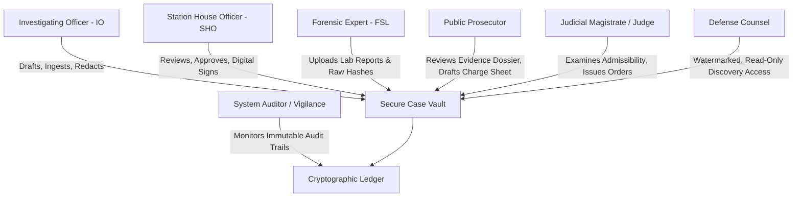
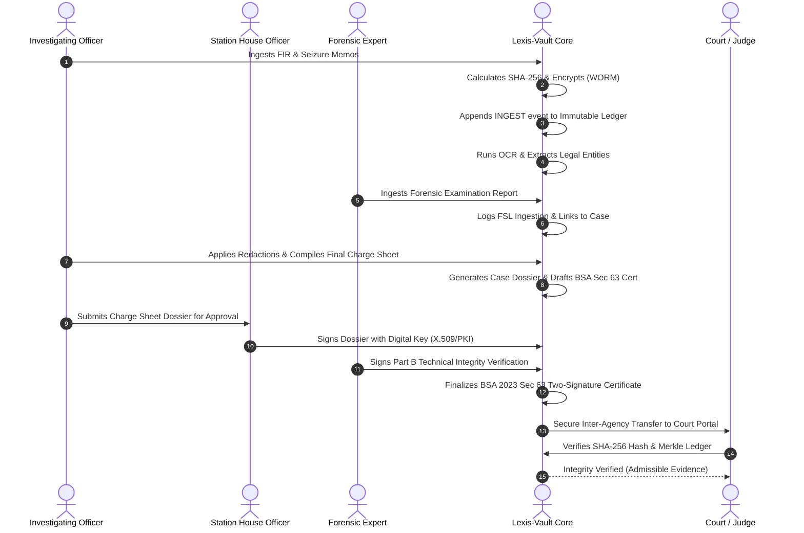

# Product Requirement Document (PRD) & Technical Specification

## Project Title
**LEXIS-VAULT**: Secure Digital Document Management & Evidence Integrity System for Legal & Investigation Documents

---

## 1. Executive Summary & Problem Understanding

### 1.1 Context & Background
Law enforcement agencies, judicial courts, prosecution offices, forensic laboratories, and investigative organizations handle massive volumes of hyper-sensitive, confidential, and legally consequential documents across the lifecycle of criminal and civil cases. 

Historically, these entities have operated on fragmented digital shares (Google Drive, local network NAS, email attachments) or physical paper files (malkhanas, case bundles). This legacy approach introduces severe systemic vulnerabilities:
- **Evidentiary Compromise & Tampering**: Digital files can be modified, metadata scrubbed, or replaced without detection, rendering evidence inadmissible in court.
- **Chain of Custody Gaps**: Inability to prove who accessed, downloaded, shared, or altered a document at an exact second.
- **Legal Non-Admissibility**: Failure to meet statutory requirements such as **Section 63 of Bharatiya Sakshya Adhiniyam (BSA), 2023** (which replaced Section 65B of the Indian Evidence Act), requiring mandatory SHA-256 hash certification and dual-signatory verification.
- **Information Silos & Inter-Departmental Delays**: Months lost transferring case files between Police Stations, Forensic Science Laboratories (FSL), Public Prosecutors, and Court Registries.
- **Unauthorized Leaks & Privacy Violations**: Leaks of sensitive case diaries, minor/POCSO victim identities, or confidential witness statements due to lack of dynamic forensic watermarking and redaction.

### 1.2 Objective & Mission
To engineer an enterprise-grade, legally admissible, and cryptographically verified **Digital Document Management System (DMS)** tailored specifically for criminal investigation and court proceedings. The platform bridges the entire lifecycle of investigation records—from the initial **First Information Report (FIR)**, through daily **Case Diaries**, **Witness Statements**, **Forensic Reports**, and **Final Form / Charge Sheets**, up to **Court Trials and Appeals**.

---

## 2. Regulatory & Legal Compliance Framework

To guarantee absolute admissibility in court, the system is architected around global and national evidentiary standards:

| Regulatory Standard | Legal / Technical Requirement | Lexis-Vault Architecture Enforcement |
| :--- | :--- | :--- |
| **BSA 2023 (Section 61 & 63)** *(India)* | Electronic records as primary/secondary documentary evidence; mandatory hash values and dual-signatory certificates (Person in charge + Technical Expert). | Automated Schedule Certificate Generator with SHA-256 hash embedding, dual digital signatures (e-Sign/PKI), and metadata capture. |
| **Section 65B Indian Evidence Act** *(Legacy)* | Admissibility of computer output and certified printouts. | Backward-compatible Sec 65B certification module. |
| **ISO/IEC 27037:2012** *(Global)* | Guidelines for digital evidence identification, collection, acquisition, and preservation. | WORM (Write Once Read Many) storage, integrity verification upon ingestion, continuous hashing. |
| **CJIS Security Policy v5.9** *(FBI/USA)* | Criminal Justice Information Services encryption, audit logging, and role separation. | AES-256-GCM envelope encryption at rest, TLS 1.3 in transit, strict ABAC/RBAC. |
| **POCSO Act & DPDP Act 2023** | Mandatory masking of juvenile and victim identifiers. | AI-powered automatic PII/victim redaction with reversible authorized role unmasking. |
| **Federal Rules of Evidence (FRE 902(11)/(13)/(14))** | Self-authenticating electronic records generated by a certified process. | Cryptographic verification report and immutable Merkle ledger audit certificate. |

---

## 3. Stakeholder Roles & Access Topology (RBAC + ABAC)

The system operates on zero-trust, attribute-based access control (ABAC) tied to jurisdiction, police station, case assignment, and statutory role:



### Role Breakdown:
1. **Investigating Officer (IO)**:
   - Ingests FIRs, General Diary excerpts, witness statements (Sec 161/164), seizure memos, panchnamas.
   - Applies automated redaction masks on sensitive victim data.
   - Compiles final case dossiers for charge sheeting.
2. **Station House Officer (SHO) / Police Chief**:
   - Supervises precinct cases; approves and cryptographically co-signs charge sheets and transfer requests.
3. **Forensic Science Laboratory (FSL) Examiner**:
   - Submits forensic reports (cyber forensics, ballistics, DNA, toxicology).
   - Generates and signs Part B (Expert) of BSA Section 63 certificates.
4. **Public Prosecutor**:
   - Accesses prosecution dossier; inspects evidence integrity; validates evidentiary consistency before court filing.
5. **Court / Judicial Magistrate / Court Clerk**:
   - Receives electronic charge sheets; verifies hash values and chain of custody; issues judicial orders/notices.
6. **Defense Counsel**:
   - Time-limited, watermarked, read-only discovery package access pursuant to fair trial rights.
7. **Compliance & Vigilance Auditor**:
   - Read-only access to the immutable Merkle tree audit ledger; monitors suspicious access patterns, failed logins, or unauthorized download attempts.

---

## 4. System Architecture & Core Modules

```
+-----------------------------------------------------------------------------------+
|                            LEXIS-VAULT PLATFORM ARCHITECTURE                     |
+-----------------------------------------------------------------------------------+
|                                                                                   |
|  +--------------------+  +--------------------+  +-----------------------------+  |
|  | Modern Web Portal  |  | Public Verification|  | Mobile/Field Officer Client |  |
|  | (React+TS+Vite UI) |  | (Courtroom QR/Hash)|  | (Responsive PWA/Tablet)     |  |
|  +---------+----------+  +---------+----------+  +--------------+--------------+  |
|            |                       |                            |                 |
|            +-----------------------+----------------------------+                 |
|                                    | (REST APIs / WebSockets / TLS 1.3)           |
|                                    v                                              |
|  +-----------------------------------------------------------------------------+  |
|  |                     API Gateway & Security Controller                       |  |
|  |  * JWT + MFA Auth  * Dynamic Forensic Watermarking  * RBAC/ABAC Evaluator   |  |
|  +---------------------------------+-------------------------------------------+  |
|                                    |                                              |
|            +-----------------------+-----------------------+                      |
|            |                                               |                      |
|            v                                               v                      |
|  +-----------------------------+               +-------------------------------+  |
|  |   Core Document Services    |               |  AI / Intelligent Processing  |  |
|  | * Ingestion & Metadata Tag  |               | * Multi-page Tesseract OCR    |  |
|  | * WORM Document Storage     |               | * Entity Extraction (NER)     |  |
|  | * Version Control & Diffs   |               | * Chronological Timeline Gen  |  |
|  | * Case Dossier Bundler      |               | * Automated PII/POCSO Redactor|  |
|  +--------------+--------------+               +---------------+---------------+  |
|                 |                                              |                  |
|                 +-----------------------+----------------------+                  |
|                                         |                                         |
|                                         v                                         |
|  +-----------------------------------------------------------------------------+  |
|  |                    Trust, Cryptography & Compliance Core                    |  |
|  | * SHA-256 / SHA-512 File Hasher   * Digital Signatures (PKI / RSA / ECDSA)  |  |
|  | * Immutable Merkle Chain-of-Custody * BSA 2023 Sec 63 Cert Generator Engine |  |
|  +--------------------------------------+--------------------------------------+  |
|                                         |                                         |
|                                         v                                         |
|  +-----------------------------------------------------------------------------+  |
|  |                           Data & Storage Persistence                        |  |
|  | * Encrypted Object Store (WORM)   * Relational DB (Cases, Documents, Users) |  |
|  | * Cryptographic Audit Block Log   * Full-Text Inverted Search Index         |  |
|  +-----------------------------------------------------------------------------+  |
+-----------------------------------------------------------------------------------+
```

### Module 1: Secure Ingestion & Cryptographic Hashing
- **Zero-Trust Ingestion**: Every file uploaded (PDF, TIFF, JPEG, DOCX) is ingested into a quarantine pipeline.
- **Dual Cryptographic Fingerprint**: Immediate computation of both **SHA-256** and **SHA-512** hashes before file bytes touch permanent storage.
- **WORM (Write Once, Read Many) Storage Model**: Original files are immutable; modifications generate versioned child objects with parent hash references.
- **Envelope Encryption**: Each document encrypted with a unique Data Encryption Key (DEK) via AES-256-GCM, wrapped by Key Encryption Key (KEK).

### Module 2: Immutable Chain of Custody (Cryptographic Ledger)
- **Merkle Tree / Hash-Chained Audit Ledger**: Every action (`INGEST`, `VIEW`, `VERIFY`, `ANNOTATE`, `REDACT`, `SHARE`, `EXPORT`, `TRANSFER`) creates an immutable block linking the previous block's cryptographic hash:
  $$\text{Block}_{n} = \text{Hash}(\text{Block}_{n-1} + \text{Timestamp} + \text{UserID} + \text{Action} + \text{DocHash} + \text{ClientIP})$$
- **Non-Repudiation**: Any attempt by a database administrator or malicious actor to modify historical records invalidates all subsequent block hashes.

### Module 3: Legal Admissibility & Section 63 BSA 2023 Engine
- **Automated Certificate Generation**: Generates official PDF certificate following the exact **Schedule of the Bharatiya Sakshya Adhiniyam, 2023**:
  - **Part A**: Officer-in-Charge declaration (identifying source device, custody integrity, operational condition).
  - **Part B**: Technical Expert declaration (cryptographic hash verification, algorithm specifications, validation checks).
- **Embedded QR Code**: Verification QR code directing to an offline/online verification endpoint confirming certificate authenticity against ledger records.

### Module 4: Intelligent Document Processing (AI / OCR & Auto-Redaction)
- **OCR Engine**: Optical character recognition for scanned police reports, handwritten FIR forms, and physical seizure memos.
- **Automated Legal Entity Extraction**:
  - Acts & Sections (e.g., IPC 302, BNS 103, NDPS Act Sec 20, POCSO Act Sec 4).
  - Dates, times, crime locations, vehicle registration numbers, weapon serial numbers.
  - Suspects, victims, informants, witness identifiers.
- **Automated PII & Sensitive Victim Redaction**:
  - Automatic detection and masking of rape/POCSO victim names, contact numbers, residential addresses, minor identities.
  - Generates redacting layers with cryptographic signature of the redacting officer.

### Module 5: Dynamic Forensic Watermarking & Leak Prevention
- **On-the-Fly Forensic Watermarking**: Whenever any user previews or exports a document, dynamic translucent watermarks are rendered diagonally across every page:
  `CONFIDENTIAL - POLICE USE ONLY | OFFICER: [Badge/Name] | IP: [IP_Address] | [Timestamp UTC] | CASE: [Case Number]`
- **Anti-Exfiltration Defense**: Discourages leaks to social media or press; forensic watermarks identify the exact leaker.

### Module 6: Court & Multi-Agency Discovery Portal
- **Case Dossier Compilation**: One-click generation of court-ready digital bundles (Indexed FIR, Case Diary, Statements, Forensic Reports, Charge Sheet).
- **Expiring Secure Links**: Public Prosecutors and Defense Counsel receive time-delimited, token-authenticated access links with IP/session restrictions.
- **Courtroom Verification Portal**: Drag-and-drop tool for judges and defense counsel to upload any document copy and instantly verify whether it is 100% genuine or tampered.

---

## 5. End-to-End Case & Document Lifecycle



---

## 6. Functional Requirements Matrix

| ID | Feature Category | Description | Priority |
| :--- | :--- | :--- | :--- |
| **FR-01** | Multi-Format Ingestion | Ingestion of PDF, Scanned TIFF/JPEG, DOCX, forensic dumps with metadata extraction. | P0 |
| **FR-02** | Cryptographic Hashing | Automatic calculation and display of SHA-256 and SHA-512 content hashes. | P0 |
| **FR-03** | Immutable Chain of Custody | Chained Merkle block ledger tracking all document interactions with timestamps. | P0 |
| **FR-04** | Role-Based Access Control | Strict role separation (IO, SHO, FSL, Prosecutor, Court, Defense, Auditor). | P0 |
| **FR-05** | BSA 2023 Sec 63 Certificate | Automated generation of 2-signature legal admissibility certificate with hash values. | P0 |
| **FR-06** | Document Verification Portal | Drag-and-drop hash comparison and cryptographic authenticity verification. | P0 |
| **FR-07** | Intelligent OCR & Search | Full-text indexing of scanned documents with keyword and entity search. | P1 |
| **FR-08** | Dynamic Forensic Watermarking | Officer name, badge number, IP, and timestamp watermarked on view/export. | P1 |
| **FR-09** | AI PII/Victim Redaction | Automated masking of sensitive names and details with audit logging. | P1 |
| **FR-10** | Case Timeline Visualizer | Auto-generation of chronological case incident and investigation timeline. | P1 |
| **FR-11** | Inter-Agency Sharing | Expiring, watermarked discovery package links for prosecution and defense. | P1 |
| **FR-12** | Tamper-Detection Alerting | Real-time alerts if any ledger or document hash mismatch is detected. | P0 |

---

## 7. Proposed Tech Stack & Implementation Blueprint

To build a clean, high-performance, and verifiable implementation:

1. **Frontend Application**:
   - **Framework**: React 18 + TypeScript + Vite.
   - **Styling**: Premium Custom Vanilla CSS Design System (Sleek dark/light theme, modern typography, glassmorphism, responsive navigation).
   - **Components**:
     - *Command Center Dashboard*: Metrics, active investigations, recent chain of custody events.
     - *Case & Evidence Explorer*: Case folders, file metadata, hash inspect modals.
     - *Document Preview & Redaction Canvas*: Document viewer with forensic dynamic watermark and redaction overlay.
     - *Chain of Custody Timeline*: Visual Merkle-chain verification viewer with node verification.
     - *BSA 2023 Section 63 Certificate Generator*: Visual interactive form with dual-signature sign-off and download.
     - *Evidentiary Authenticity Verifier*: Instant drag-and-drop file hash check with green/red verification badges.
2. **Backend API & Cryptographic Engine**:
   - **Framework**: Node.js + Express (TypeScript) or Python (FastAPI).
   - **Cryptography**: `crypto` / `hashlib` (SHA-256, SHA-512, HMAC, AES-256-GCM).
   - **Ledger Engine**: Built-in cryptographic hash-chained block storage with Merkle root computation.
   - **OCR / Parsing**: Text extraction, regex legal entity tagging, metadata indexing.
   - **PDF & Certificate Generation**: Dynamic PDF/A generator with embedded SHA-256 fingerprints, QR code, and statutory declarations.
3. **Data Model & Storage**:
   - In-memory / SQLite / JSON-backed persistent store for Cases, Documents, Users, Redaction Layers, and Ledger Blocks.

---

## 8. Implementation Milestones

- **Phase 1 (Foundation & Cryptographic Vault)**:
  - Project setup, models, cryptographic hashing engine, WORM storage abstraction, and Merkle ledger.
- **Phase 2 (Document Ingestion, Metadata & Access Control)**:
  - Upload pipeline, case grouping, multi-role auth simulation (IO, SHO, FSL, Prosecutor, Judge), and permission rules.
- **Phase 3 (Legal Admissibility & Certificate Generator)**:
  - BSA 2023 Section 63 Schedule certificate generator (Part A & Part B), Section 65B fallback, and QR code verification.
- **Phase 4 (AI Processing, OCR, Redaction & Watermarking)**:
  - Text search, entity extraction (Sections of law, suspects, dates), redaction canvas, dynamic forensic watermarks.
- **Phase 5 (Verification Portal & Executive UI Polish)**:
  - Interactive verification suite, chain of custody explorer, audit exporter, UI testing, and documentation.
